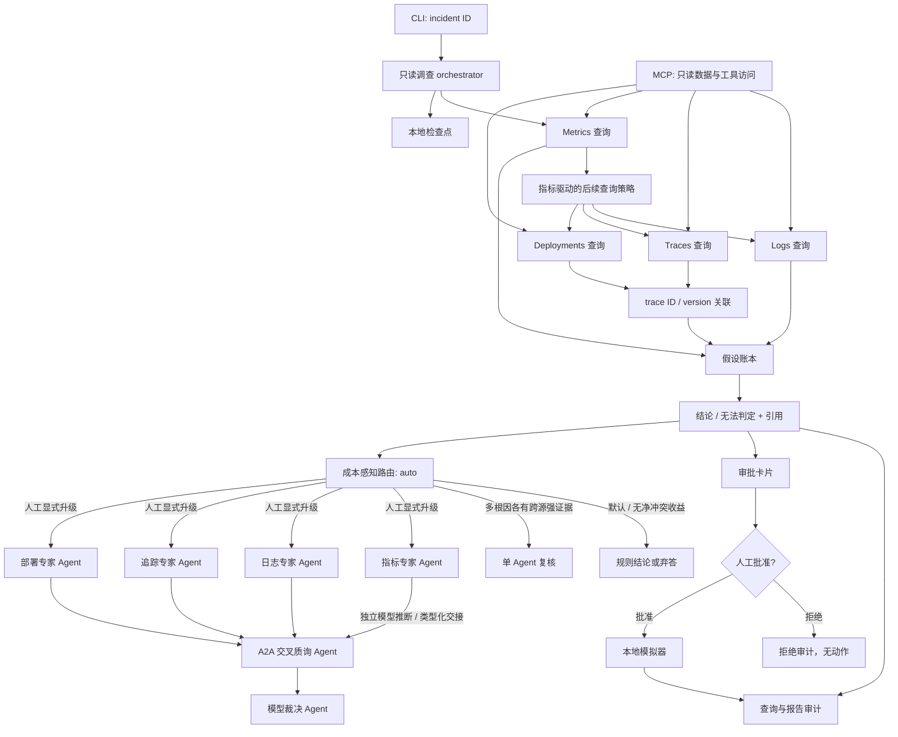

# OpsPilot 本地原型架构

检查点和审计文件只保存在本机 `var/`。MCP 服务只读本地合成数据；批准动作只进入模拟器。

`auto` 只在多个根因各自获得至少两个独立来源的强证据时调用单 Agent；其他情况保持规则结论或安全弃答。多 Agent 保留显式调用，用于人工要求独立专家交叉质询的跨团队争议。复杂集验证与测试没有测出多 Agent 相对单 Agent 的根因或引用收益，因此它不在自动路由里。

MCP 描述 Agent 如何访问工具与数据；A2A 描述独立 Agent 如何发现能力、委派 task、传递 message 和接收 artifact。OpsPilot 交叉质询边界在 `127.0.0.1` 上使用 A2A v0.3 JSON-RPC，不承载工具访问。当前只实现项目所需方法，不宣称完整 A2A 合规。
